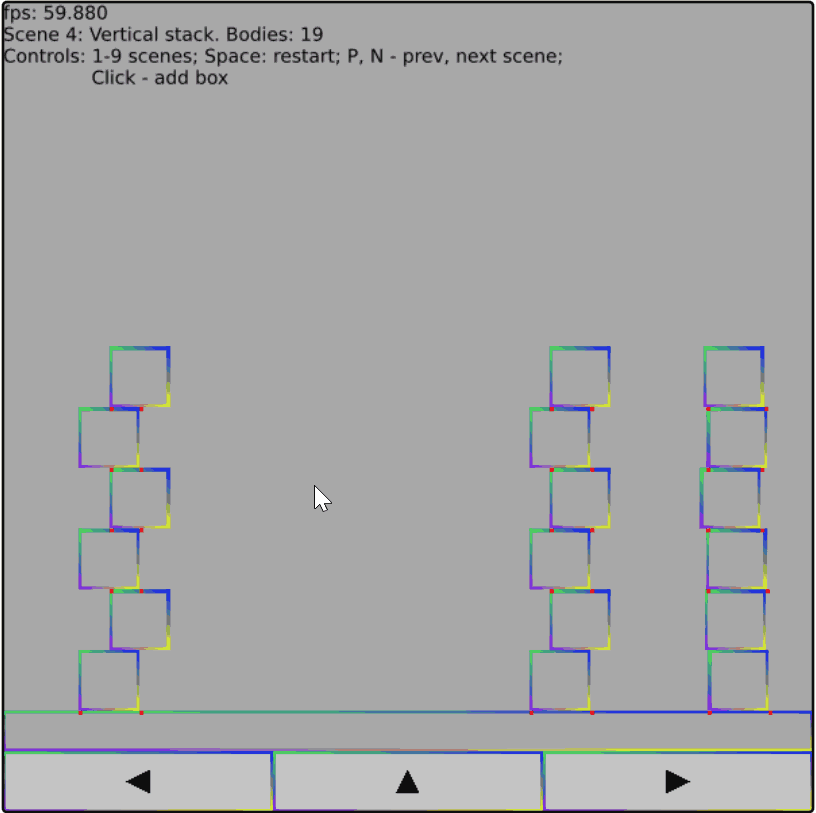

# Box2D-Lite-rs
Box2D-Lite is a small 2D physics engine. It was developed for the [2006 GDC Physics Tutorial](docs/GDC2006_Catto_Erin_PhysicsTutorial.pdf). This is the original version of the larger [Box2D](https://box2d.org) library. The Lite version is more suitable for learning about game physics.  

Original C++ version: https://github.com/erincatto/box2d-lite/tree/master  
Big thanks to the author Erin Catto.  

Check runnable version online: [winit](https://xcemaxx.github.io/box2d-lite-rs/winit_version), 
[macroquad](https://xcemaxx.github.io/box2d-lite-rs/macroquad_version) 

# Building and running
Both versions build in release mode by default. Pass `--dev` for a debug build.

## Winit version
- Install wasm-bindgen-cli with the same version as the `wasm-bindgen` crate in `Cargo.lock`:
`cargo install wasm-bindgen-cli --version <version> --locked`
- Build: `./gui/build.sh`
- Run server: `cd gui && python -m http.server 7000`
- Open site: http://localhost:7000

## Macroquad version
- Build: `./gui_macroquad/build.sh`
- Run server: `cd gui_macroquad && python -m http.server 7001`
- Open site: http://localhost:7001
- After a macroquad update, copy `js/mq_js_bundle.js` from the macroquad repository (same tag) to `gui_macroquad/pkg/`.

# Show
[Check by yourself online winit version](https://xcemaxx.github.io/box2d-lite-rs/winit_version)  
[Check by yourself online macroquad version](https://xcemaxx.github.io/box2d-lite-rs/macroquad_version)  

# Helpful resources
## Wgpu
https://github.com/vhiribarren/wgpu-sandbox/tree/main  
https://github.com/gfx-rs/wgpu/tree/trunk/examples/src/hello_triangle  
https://github.com/Blatko1/wgpu-text/tree/master  
https://github.com/sotrh/learn-wgpu/tree/master/code/showcase/pong/src  
https://github.com/jack1232/WebGPU-Step-By-Step  

## Wasm
https://blog.logrocket.com/getting-started-with-webassembly-and-rust/  
https://github.com/rustwasm/wasm-bindgen  
https://rustwasm.github.io/docs/book/game-of-life/hello-world.html  